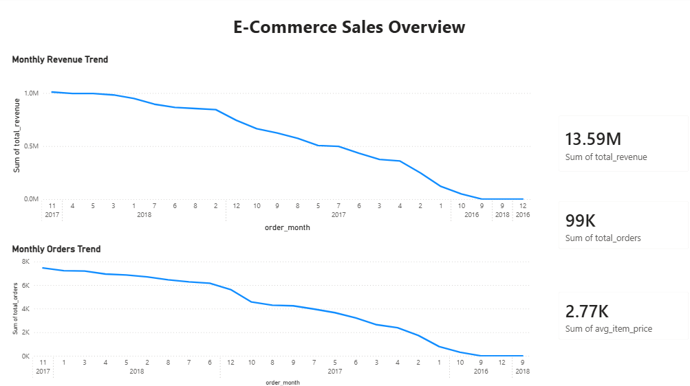
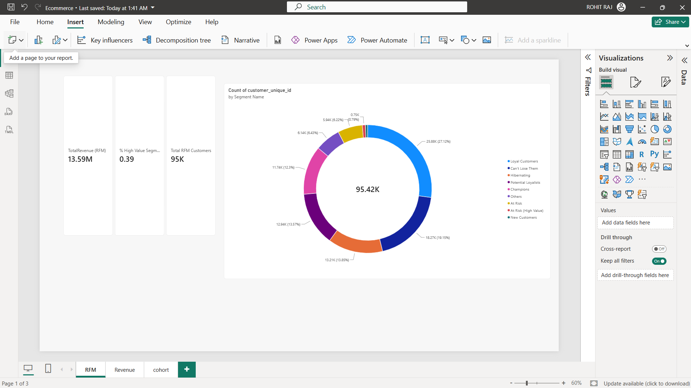
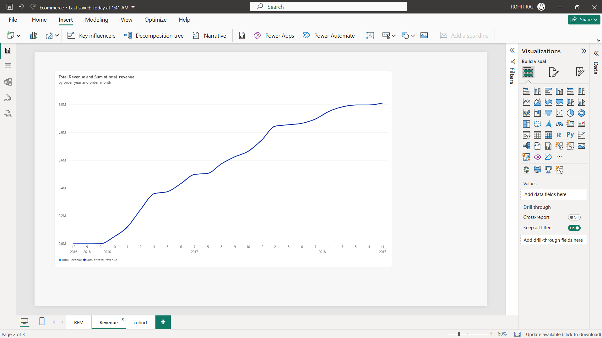
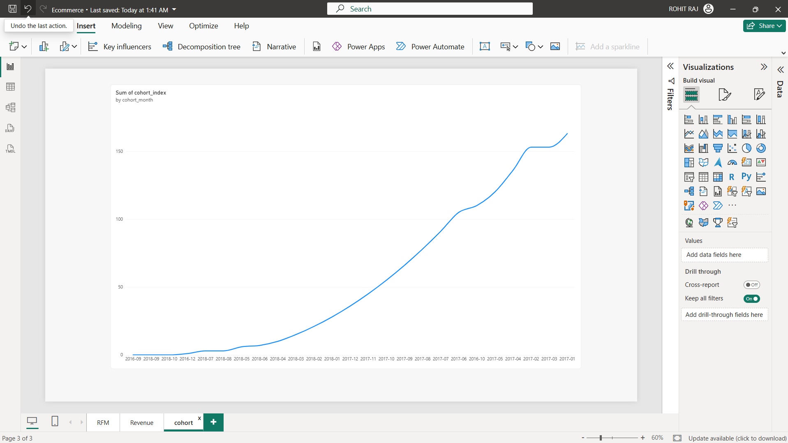
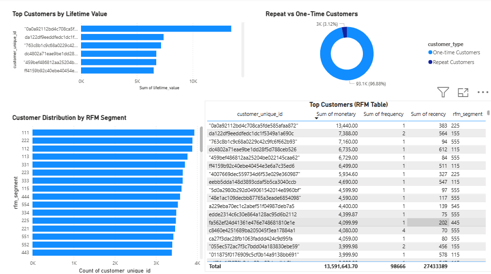
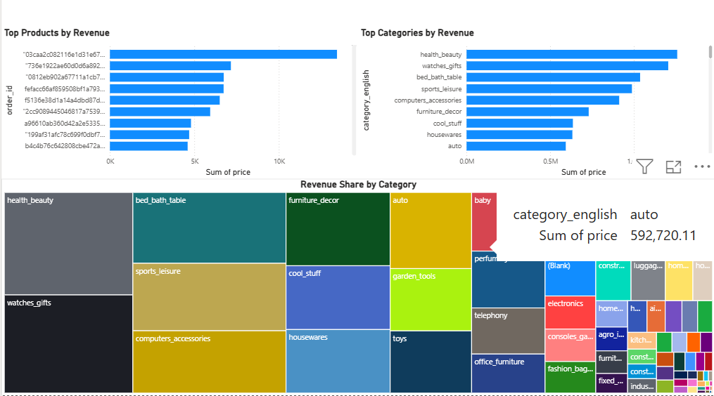

# E-Commerce Sales & Customer Analytics Platform

### SQL Server | Power BI | DAX | Customer Analytics

## 1. Project Overview

An end-to-end E-Commerce Sales and Customer Analytics project using the Brazilian E-Commerce Public Dataset by Olist.

This project explores transactional data to understand sales performance, customer purchasing behaviour, customer retention, lifetime value, and product performance.

**Analytics Workflow:**

Raw Data → Data Cleaning → SQL Analysis → Customer Segmentation → Business Insights → Power BI Dashboard

## 2. Business Objectives

- Analyze sales and revenue performance.
- Understand customer purchasing behaviour.
- Measure repeat purchases and customer retention.
- Analyze Customer Lifetime Value (LTV).
- Identify high-value and at-risk customer segments.
- Evaluate product and category performance.
- Develop interactive business intelligence dashboards.

## 3. Dataset

**Brazilian E-Commerce Public Dataset by Olist — Kaggle**

The dataset contains approximately 100,000 orders and information about customers, orders, products, sellers, payments, reviews, and delivery locations.

### Dataset Files

- `olist_customers_dataset.csv`
- `olist_orders_dataset.csv`
- `olist_order_items_dataset.csv`
- `olist_order_payments_dataset.csv`
- `olist_products_dataset.csv`
- `olist_sellers_dataset.csv`
- `olist_order_reviews_dataset.csv`
- `product_category_name_translation.csv`
- `olist_geolocation_dataset.csv`

## 4. Technology Stack

| Category | Tools |
|---|---|
| Database | Microsoft SQL Server |
| Query Language | SQL |
| Data Cleaning | SQL Transformations |
| Analytics | Business & Customer Analytics |
| Segmentation | RFM Analysis |
| Retention | Cohort Analysis |
| Visualization | Microsoft Power BI |
| Calculations | DAX |
| Dataset | Olist Public Dataset |

## 5. Project Architecture

```text
Olist CSV Dataset
       |
       v
Raw Data Tables
       |
       v
Data Cleaning & Transformation
       |
       v
Clean Analytical Tables
       |
       v
Business KPI Analysis
       |
       v
RFM & Cohort Analysis
       |
       v
SQL Reporting Views
       |
       v
Power BI Dashboard
       |
       v
Business Insights
```

## 6. SQL Data Processing

The SQL scripts are organized into the following stages:

1. Database creation.
2. Raw table creation.
3. CSV data ingestion.
4. Data cleaning and transformation.
5. Business KPI queries.
6. RFM customer segmentation.
7. Cohort retention analysis.
8. Reporting views.
9. Geolocation analysis extension.

### Data Cleaning Techniques

- `TRY_CAST()` for safe data type conversion.
- `LTRIM()` and `RTRIM()` for text cleaning.
- Date and timestamp conversion.
- Handling missing and invalid values.
- Data validation and standardization.

## 7. Business KPIs

The project covers the following business metrics:

- Total Orders
- Total Revenue
- Average Order Value (AOV)
- Customer Lifetime Value (LTV)
- Repeat vs One-Time Customers
- Monthly Revenue Trends
- Top Products by Revenue
- Top Categories by Revenue

## 8. Advanced Customer Analytics

### RFM Segmentation

Customers are analyzed using three dimensions:

- **Recency:** Days since the customer's last purchase.
- **Frequency:** Number of customer orders.
- **Monetary:** Total customer spending.

SQL `NTILE()` scoring is used to classify customers into segments such as:

- Champions
- Loyal Customers
- New Customers
- At Risk
- Can't Lose Them
- Hibernating

### Cohort Analysis

Customers are grouped by their first purchase month. Their subsequent purchasing behaviour is tracked across monthly cohorts to understand customer retention patterns.

## 9. Power BI Dashboard

The repository includes Power BI report files and dashboard previews covering six analytical areas:

1. Sales Overview
2. RFM Customer Segmentation
3. Revenue Analysis
4. Cohort Retention
5. Customer Analytics
6. Product Performance

The interactive reports can be explored using Microsoft Power BI Desktop.

## 10. Dashboard Screenshots

### 1. Sales Overview



### 2. RFM Customer Segmentation



### 3. Revenue Analysis



### 4. Cohort Retention



### 5. Customer Analytics



### 6. Product Performance



## 11. Business Insights

The analysis explores:

- Customer loyalty and repeat purchase behaviour.
- High-value and at-risk customer segments.
- Revenue contribution across customer segments.
- Customer retention across acquisition cohorts.
- Product and category revenue performance.

Detailed findings and recommendations:

[`insight/business_insights.md`](insight/business_insights.md)

## 12. Repository Structure

```text
Analytics_customer-main/
│
├── Dashboard/
│   ├── Ecommerce_Analytics_Dashboard.pbix
│   ├── Ecommerce.pbix
│   ├── sales_overview.png
│   ├── RFM.png
│   ├── Revenue.png
│   ├── cohort.png
│   ├── customer_analytics.png
│   └── product_performance.png
│
├── data/
│   └── Olist CSV datasets
│
├── insight/
│   └── business_insights.md
│
├── sql/
│   ├── 01_create_database.sql
│   ├── 02_create_raw_tables.sql
│   ├── 03_bulk_insert.sql
│   ├── 04_clean_tables.sql
│   ├── 05_business_queries.sql
│   ├── 06_rfm_analysis.sql
│   ├── 07_cohort_analysis.sql
│   ├── 08_views.sql
│   └── 09_geolocation_extension.sql
│
├── LICENSE
└── README.md
```

## 13. How to Run

### Requirements

- Microsoft SQL Server
- SQL Server Management Studio (SSMS)
- Microsoft Power BI Desktop

### Execution Steps

1. Clone or download the repository.
2. Open SQL Server Management Studio.
3. Execute the SQL scripts in numerical order.
4. Update the CSV file paths in the bulk import script for your local system.
5. Validate the cleaned tables and analytical outputs.
6. Open the Power BI report in Power BI Desktop.
7. Configure the database connection and refresh the reports.

## 14. Project Outcomes

This project demonstrates practical application of:

- Relational database concepts.
- SQL-based data cleaning and transformation.
- Business KPI analysis.
- Customer lifetime value analysis.
- RFM customer segmentation.
- Cohort retention analysis.
- Power BI reporting and visualization.
- Business insight generation.

## 15. Contributions & Attribution

**Portfolio customization and documentation: Arun Banoth.**

This repository is an adapted and customized analytics project. The attribution and applicable license notices for the original work and third-party materials are retained. Contributions described here should reflect the actual modifications and validation performed.

## 16. Data Disclaimer

This project uses the publicly available Olist Brazilian E-Commerce dataset. Findings are specific to the dataset and should not be interpreted as current commercial business results.

All analytical metrics should be validated against the underlying SQL queries and Power BI reports before being used for business decisions.